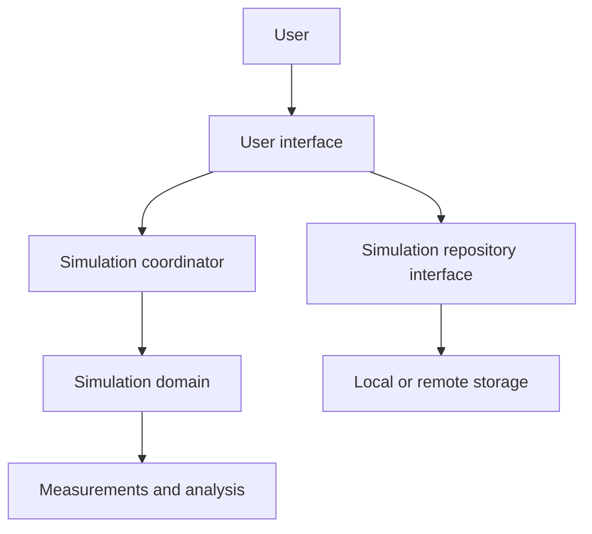

# Freeway Traffic Simulator: Project Blueprint

## 1. Purpose

We are building an interactive freeway traffic simulator that focuses on microscopic analysis and how different rules impact the flow of traffic in a bounded freeway road.

The simulator will let a user configure a road and a population of vehicles, run the simulation over time, observe traffic behavior, and inspect measurements such as speed, density, lane usage, throughput, and traffic-pack formation.

The project is being built in phases using a combination of different SWARM behavior models, most of which have been implemented with traffic before. As project evolves and data is collected, there may be some modification in these models, and we may apply other models in swarm behavior yet to be experimented with traffic. 


## 2. Product concept

The user should be able to:

1. Define a freeway using length, number of lanes, and traffic parameters.
2. Create an initial population of vehicles.
3. Start, pause, reset, and stop a simulation.
4. See vehicles move and respond to nearby vehicles.
5. Change selected simulation parameters.
6. View measurements from the run.
7. Save and reload a simulation only after the local simulation workflow is stable.

The built in simple milestone achievements such as:

> Given a road length and traffic density, calculate the initial number of vehicles, display the result, and verify the calculation with automated tests.

## 3. Proposed architecture



### 3.1 User interface

Responsible for displaying information and collecting user actions.

The UI should not calculate vehicle physics, decide how many vehicles fit on a road, or call a database directly. It should send clear commands and display results.

 future technologies: React and TypeScript.

### 3.2 Simulation coordinator

Responsible for controlling a run:

- initialize a simulation;
- start, pause, resume, reset, and stop it;
- advance the simulation by time steps;
- deliver simulation state to the UI;
- later, move the ticking loop behind a Web Worker if necessary.

This layer coordinates work but should not contain the traffic equations themselves.

### 3.3 Simulation domain

Responsible for the rules of the traffic model:

- road and lane representation;
- vehicle state;
- initial vehicle-count calculation;
- vehicle placement;
- car-following behavior;
- acceleration and braking;
- lane-changing behavior;
- time-step updates.

This layer should be usable without React, a browser DOM, a database, or network access.

### 3.4 Measurements and analysis

Responsible for deriving observations from simulation state:

- average speed;
- density;
- throughput;
- lane utilization;
- vehicle or driver statistics;
- traffic-pack measurements.

Measurements should be pure functions where practical. A measurement can then be tested with fixed input state and expected output.

### 3.5 Persistence

Responsible for saving and loading simulation definitions and results.

The UI should depend on a small repository contract rather than on IndexedDB, HTTP, MongoDB, or a specific vendor. A local implementation can come first; a server implementation can be added later.

## 4. Design principles

### Prefer composition over inheritance

The model contains different kinds of vehicles and drivers, but they do not automatically require a class hierarchy. We will begin with explicit data types and functions.

If multiple interchangeable algorithms emerge, we can define an interface such as a car-following or lane-changing strategy and provide separate implementations. We will add polymorphism when it removes a real conditional or supports a real variation.

### Keep domain rules pure where possible

A function should receive its inputs and return its result without relying on UI state, current time, random global state, or network access. Pure functions are easier to understand and test.

### Make units explicit

Every physical quantity must document its unit. Examples:

- road length: kilometers;
- vehicle position: meters or kilometers, chosen explicitly;
- speed: kilometers per hour;
- time step: seconds;
- density: vehicles per kilometer;
- distance: meters or kilometers, chosen explicitly.

Conversions should happen in named functions rather than being scattered through calculations.

### Make randomness controllable

The simulation may use randomness for vehicle types, speeds, and driver behavior. Tests must be able to use a seed or injected random-number source so that a scenario can be reproduced.

### One ownership location for each rule

A rule such as the initial vehicle-count calculation should have one production implementation. The UI, worker, and persistence layers should call it rather than reimplementing it.

## 5. Initial domain model

The first domain types will be small and expanded only when a feature needs them.

```text
Road
- length
- lane count

## may not mount to a type implementation 

TrafficDemand
- density
- vehicle-type distribution
- driver-type distribution

Vehicle
- identifier
- vehicle type
- lane
- position
- speed
- desired speed

SimulationState
- elapsed time
- road
- vehicles
- status

SimulationParameters
- road configuration
- traffic demand
- time-step settings
```

The exact TypeScript representation is intentionally deferred until the first implementation step. Types should describe real domain concepts, not reproduce every field from the reference application before those fields are needed.


## 6. Build sequence

### Phase 0: Project contract

- Keep this blueprint current.
- Choose project tooling only when the first implementation needs it.
- Establish a test command and a build command.
- Record decisions and assumptions in this document.

### Phase 1: Pure calculation

- Define the smallest input type for road length and traffic density.
- Implement the initial vehicle-count calculation.
- Add tests for a whole-number result, a fractional result, and invalid input behavior if invalid input is supported.
- Run the focused tests and build.

### Phase 2: Road and vehicle state

- Define road, lane, vehicle, and simulation-state types.
- Create vehicles from parameters.
- Test vehicle count, lane distribution, and initial placement.
- Avoid animation and React until the state model is understandable.

### Phase 3: One simulation time step

- Implement a function that advances one state by a fixed time step.
- Begin with simple movement.
- Test elapsed time, position changes, and boundary behavior.
- Add car-following behavior only after basic movement is stable.

### Phase 4: Traffic behavior

- Add car-following rules.
- Add braking and acceleration.
- Add lane-changing decisions.
- Keep each behavior separately testable.
- Use deterministic scenarios before introducing broad random populations.

### Phase 5: Minimal user interface

- Add a small React interface for parameters and simulation status.
- Render the road and vehicles.
- Connect UI actions to the coordinator.
- Test important user workflows rather than testing every visual detail.

### Phase 6: Real-time execution

- Add a browser timing loop.If 
- Compare real-time execution with the deterministic time-step function.
- Move ticking to a Web Worker only when the UI needs it.
- Define and test the worker message contract.

### Phase 7: Measurements

- Add pure measurement functions.
- Display a small number of useful metrics.
- Test each metric with hand-built simulation states.

### Phase 8: Persistence

- Define a simulation repository interface.
- Add local save/load first.
- Add API and database storage only after the local workflow is stable.
- Test serialization and repository behavior independently from the UI.

## 7. Testing policy

Every implementation change must have an appropriate check before it is considered complete.

Use the narrowest useful test first:

1. pure function test;
2. domain-state test;
3. coordinator test;
4. component or user-workflow test;
5. integration test for persistence or worker communication;
6. build check.

A change is not complete merely because the application opens. For each new behavior, record:

- the input scenario;
- the expected result;
- the automated test;
- the command used to run it;
- any remaining limitation.

## 8. Definition of done for each slice

A slice is complete when:

- its purpose is stated in plain language;
- its public inputs and outputs are clear;
- its code has one obvious owner;
- its focused tests pass;
- the project still builds;
- the design document records important decisions;


